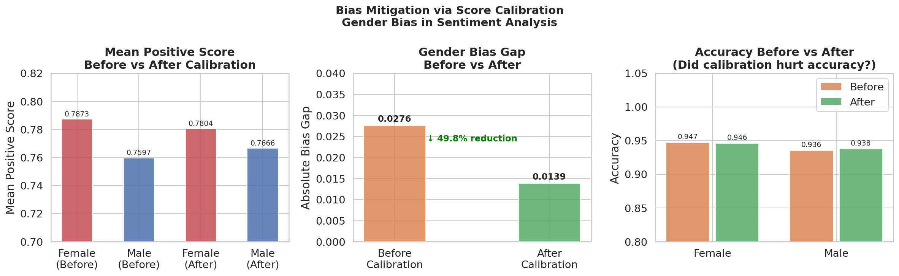

# Can We Fix Bias in Sentiment Models?

**Author:** Krishna Varshini Ilindra  
**Background:** M.S. in Computer Science, University of Bridgeport  
&nbsp;&nbsp;&nbsp;&nbsp;&nbsp;&nbsp;&nbsp;&nbsp;&nbsp;&nbsp;&nbsp;&nbsp;&nbsp;&nbsp;&nbsp;&nbsp;&nbsp;&nbsp;&nbsp;&nbsp;&nbsp;Software Developer  
**Run the notebook:** [Open in Colab](https://github.com/krishna-Varshini-Ilindra/bias-mitigation-nlp)

---

## The Starting Point

In my previous project, I measured demographic bias in sentiment 
analysis models and found that female-associated text consistently 
received higher positive sentiment scores than identical 
male-associated text — a gap of 0.0276.

Finding the bias felt incomplete. The natural next question was: 
can it actually be fixed?

That's what this project explores.

---

## The Approach

Rather than retraining the model from scratch — which requires 
significant compute and time — I tested a lightweight technique 
called **Post-hoc Score Calibration**.

The idea is simple:
- Calculate how much each gender group is systematically 
  over or under-scored on average
- Subtract that offset from their predictions
- Measure whether the gap closed — and whether accuracy suffered

No retraining. No additional data collection. Just a mathematical 
adjustment applied after the model makes its predictions.

This approach matters because in real-world production systems, 
retraining is often not an option. A fast, deployable fix is 
far more practical.

---

## Results

| Metric | Before Calibration | After Calibration |
|---|---|---|
| Gender bias gap | 0.0276 | 0.0139 |
| Female accuracy | 0.947 | 0.946 |
| Male accuracy | 0.936 | 0.938 |
| **Bias reduction** | — | **49.8%** |

---

## Visualization

---

## Key Finding

A **49.8% reduction in gender bias** was achieved using score 
calibration — with less than 0.1% drop in accuracy for either group.

This shows that meaningful fairness improvements are possible 
without expensive model retraining — making calibration a 
practical tool for real-world NLP deployments.

---

## Open Questions

This project raises further questions worth investigating:

- Does calibration hold when tested on real-world social media 
  data beyond controlled templates?
- Can the same technique reduce racial and dialect bias 
  simultaneously?
- What happens when bias is intersectional — race and gender 
  combined?

---

## Connection to Project 1

This is the second part of a two-project series on fairness 
in NLP:

- [Project 1 — Measuring Bias](https://github.com/krishna-Varshini-Ilindra/sentiment-bias-nlp): 
  Found gender gap of 0.0276 and dialect confidence asymmetry 
  across SAE and AAE text
- **Project 2 — Fixing Bias** (this repo): 
  Reduced the gender gap by 49.8% using score calibration

---

## How to Run

1. Click **Open in Colab** above
2. Runtime → Change runtime type → **T4 GPU**
3. Run all cells top to bottom

---

## References

- Kiritchenko & Mohammad (2018). Examining Gender and Race Bias 
  in Two Hundred Sentiment Analysis Systems. SemEval 2018.
- Zhao et al. (2018). Gender Bias in Coreference Resolution: 
  Evaluation and Debiasing Methods. NAACL 2018.
- Agrawal et al. (2020). A Comprehensive Analysis of Preprocessing 
  for Word Representation Learning in Affective Tasks. ACL 2020.
